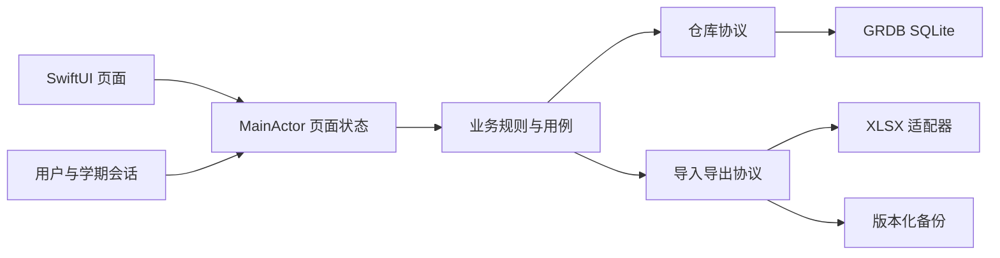

# 学迹 StudyTrack：iOS 版本开发实施文档

版本：1.0（开发基线草案）  
编制日期：2026-10-12  
适用工程：`E:\Project\StudyTrack`  
目标读者：项目维护者、iOS 开发者、测试人员及后续接手开发的编码代理。

> 本文定义待实现的 iOS 方案，不代表 iOS 功能已经完成。当前工作区只有 Android 工程；尚未执行 iOS 编译、签名、TestFlight 分发或真机性能验证。标为“默认方案”的内容是可执行建议，产品取舍尚未由项目负责人最终确认。

## 1. 目标、范围与交付定义

### 1.1 项目目标

在保留学迹本地离线成绩管理能力的基础上，新增独立的原生 iOS 应用。iOS 26 及以上使用 Apple 公开 Liquid Glass API，导航、录入、文件操作、无障碍和生命周期遵循 iOS 使用方式。开发者在 Windows 编写代码，通过 GitHub Actions 的 macOS runner 编译和测试，通过 TestFlight 在 iPhone 上验证。

“完整适配”定义为：核心业务功能对应完整、已存在数据能够按明确规则迁入、平台差异有合理替代、数据不会因失败操作而静默损坏，并具备可重复构建与分发能力。Android 光学参数逐项照搬不属于验收要求。

### 1.2 首版默认范围

| 项目 | 默认方案 | 状态与原因 |
|---|---|---|
| 开发路线 | 独立 Swift + SwiftUI 客户端 | 建议；降低首版桥接与构建复杂度 |
| 最低系统 | iOS 26.0 | 建议；用户指定 26+ 原生玻璃，但尚未决定是否兼容旧系统 |
| 设备 | iPhone；支持竖屏及横屏自适应 | 建议；iPad 原生分栏另列后续范围 |
| 语言 | 简体中文；资源使用 String Catalog | 建议；为后续本地化保留结构 |
| 数据 | 本地离线、多用户、多学期 | 保持 Android 核心能力 |
| 主题 | 简洁主题、液态玻璃主题；外观跟随系统 | 建议；简洁主题在深色模式使用深色内容底色 |
| 分发 | TestFlight 验证，App Store 正式发布 | 建议；需要开发者账号与签名材料 |
| Excel | `.xlsx` 导入与导出 | 必须；旧 `.xls` 支持情况见第 9 节 |
| 完整备份 | iOS 导出与恢复；Android 迁移需补导出适配器 | 必须明确跨端前置条件 |
| 网络账号、云同步、广告 | 首版不引入 | 建议；本地用户档案不等于网络账号 |
| 打赏 | 首版保留关于与支持说明，支付单独评估 | 建议；不直接移植扫码收款页 |

若最低系统改为 iOS 18，必须增加玻璃可用性判断、普通材质回退和旧系统测试矩阵，不能仅修改 deployment target。若加入 iPad，需同时增加分栏、分屏、键盘操作和窗口状态设计。

### 1.3 完成门槛

1. 首次启动到创建用户和学期、添加科目、单条/批量成绩录入、编辑/删除、分析、导入导出形成闭环。
2. 用户和学期隔离、重复记录、日期、评分和统计通过固定样例验证。
3. Android 导出 `.xlsx` 可被 iOS 导入；iOS 导出可被 Android 当前解析器读取。
4. 完整备份可恢复用户、学期、空科目、成绩和可迁移设置；跨端完整搬家以 Android 导出适配器完成为前提。
5. 提交触发模拟器 CI；发布入口可生成签名 Archive 并上传 TestFlight。
6. iPhone 真机完成玻璃、返回手势、键盘、文件选择、后台恢复及基础性能验收。
7. 开发文档、测试夹具、依赖锁文件、构建脚本、发布记录可交给新维护者复现。

## 2. Android 现状与证据

以下为本轮源码核查事实，不以 README 的描述代替代码行为。相对路径均以项目根目录为基准。

| 范围 | 当前事实 | 迁移影响 |
|---|---|---|
| 构建 | Android 单模块；Kotlin 2.2.21、Compose、Hilt | 没有现成 iOS target |
| 页面 | 约 10 个页面 Kotlin 文件，5 个底部入口 | 需要建立 iOS 对应流程 |
| 数据 | Room v4，4 类实体，`exportSchema = false` | iOS schema 独立编号；不可直接套用 Room 版本 |
| 作用域 | 仓库读取偏好中的当前用户/学期；部分数据先全量取出再过滤 | 新接口显式传 scope，数据库下推过滤 |
| 导入 | `SettingsViewModel` 导入过程中逐行切换当前学期 | iOS 禁止借修改全局选择实现导入 |
| Excel | Apache POI + Android URI/文件接口 | iOS 替换读写引擎和文件访问 |
| 日期 | 考试日期保存为毫秒时间戳 | 跨端需转换为明确日历日期 |
| 评分 | A≥85%、B≥75%、C≥60%、否则 D | 应作为兼容业务规则 |
| 图表 | 当前页面使用自定义 Compose Canvas；依赖 Android Paint/nativeCanvas | 不能直接用于 iOS；Gradle 中 MPAndroidChart 声明不代表实际页面使用它 |
| 玻璃 | backdrop 库，折射/模糊/色差等可调 | 无法逐参数映射 Apple 原生玻璃 |
| 备份 | Excel 仅导出当前学期成绩字段 | 不覆盖全部用户、空科目、偏好和壁纸 |
| Git | 本地 `git status` 返回非 Git 仓库 | 当前目录可能来自压缩包；建立 CI 前先确认远程及分支 |

关键证据路径：

```text
app/build.gradle.kts
app/src/main/java/com/repea/studytrack/data/local/AppDatabase.kt
app/src/main/java/com/repea/studytrack/data/local/entity/
app/src/main/java/com/repea/studytrack/data/local/dao/
app/src/main/java/com/repea/studytrack/repository/StudyRepositoryImpl.kt
app/src/main/java/com/repea/studytrack/viewmodel/SettingsViewModel.kt
app/src/main/java/com/repea/studytrack/viewmodel/UserManagerViewModel.kt
app/src/main/java/com/repea/studytrack/utils/ExcelHelper.kt
app/src/main/java/com/repea/studytrack/utils/GradeCalculator.kt
app/src/main/java/com/repea/studytrack/ui/screens/HomeScreen.kt
app/src/main/java/com/repea/studytrack/ui/screens/AnalysisScreen.kt
app/src/main/java/com/repea/studytrack/ui/components/GlassComponents.kt
app/src/main/java/com/repea/studytrack/ui/components/SimpleLineChart.kt
app/src/main/java/com/repea/studytrack/ui/components/SimplePieChart.kt
```

## 3. 技术路线与依赖决策

### 3.1 首版选择

SwiftUI 负责界面，Observation 管理界面状态，Swift Concurrency 管理异步任务，GRDB/SQLite 负责业务持久化，Swift Charts 负责图表。使用构造器注入服务；不引入大型依赖注入框架。

选择显式 SQLite schema 的原因是本项目依赖唯一约束、关联关系、批量导入事务及数据交换。相比首版直接使用 SwiftData，GRDB 更便于把这些规则写成可验证的数据库约束；代价是需要自行维护 SQL migration 和模型映射。此为本项目的设计判断，并非通用框架性能结论。

| 能力 | 方案 | 接入条件 |
|---|---|---|
| 界面/导航 | SwiftUI `TabView`、`NavigationStack`、sheet | Apple SDK；不移植 Material 组件 |
| 状态 | `@Observable` + `@MainActor` 页面模型 | UI 修改回主 actor |
| 数据 | GRDB.swift，SPM 接入 | 锁定经 CI 验证的 tag/revision |
| 设置 | 数据库版本化配置；UserDefaults仅缓存可重建界面状态 | 备份/恢复所需设置与业务库原子提交 |
| 图表 | Swift Charts | 对排名反向坐标、缺失值做夹具验证 |
| 壁纸 | PhotosPicker + ImageIO 降采样 + 沙盒文件 | 不长期依赖照片选择器临时 URL |
| XLSX 读取 | CoreXLSX 候选 | 只读 `.xlsx`；需实际样例验证 |
| XLSX 写入 | libxlsxwriter 候选，包装为 Swift 服务 | 官方仓库有 Package.swift；真机/模拟器链接仍待 POC |
| 备份 ZIP | ZIPFoundation 候选 | 校验路径、解压限制和恢复流程 |
| 工程生成 | XcodeGen | CI 安装固定发行版，校验来源与摘要 |
| CI | GitHub Actions macOS runner | Xcode/SDK/模拟器组合通过环境探针锁定 |

第三方能力依据：[GRDB](https://github.com/groue/GRDB.swift)、[CoreXLSX](https://github.com/CoreOffice/CoreXLSX)、[libxlsxwriter](https://github.com/jmcnamara/libxlsxwriter)、[libxlsxwriter Package.swift](https://github.com/jmcnamara/libxlsxwriter/blob/main/Package.swift)、[ZIPFoundation](https://github.com/weichsel/ZIPFoundation)、[XcodeGen](https://github.com/yonaskolb/XcodeGen)。以上为候选依赖，维护状态、许可证、传递依赖及 Swift 6 编译兼容性在接入时再次确认。

### 3.2 版本管理规则

- 使用正式版 Xcode，项目语言模式默认 Swift 6；不依赖 beta API。
- SPM 依赖在首次 POC 后写入明确版本及 `Package.resolved`，提交锁文件；不能把动态 `main` 当发布依赖。
- XcodeGen 固定 tag 和下载摘要，不能把 `brew install xcodegen` 的浮动结果当锁定版本。
- CI 开头输出 Xcode、Swift、SDK、模拟器 runtime、XcodeGen 及依赖 revision。
- macOS 标签只固定镜像系列，不是不可变系统快照；同标签变更也必须有失败报告。
- 不为尚未跑通的依赖编造“已验证版本”。M0 产出 `ios/Toolchain.lock.json`，记录实际可用组合。

### 3.3 KMP 的后续边界

首版不改 Android 架构。Domain 层不依赖 SwiftUI/GRDB，Repository 使用协议，跨端格式独立版本化。未来需要 KMP 时可替换计算和仓库实现，SwiftUI 页面继续保留。

引入 KMP 的触发条件：两端业务变更频繁重复、已有稳定跨端规则测试、共享收益超过 Kotlin/Swift 桥接和双工具链维护成本。Room/DataStore 有官方 KMP 支持，但当前 `Context`、Hilt、`SupportSQLiteDatabase` 使用仍需重构。[Room KMP](https://developer.android.com/kotlin/multiplatform/room)、[DataStore KMP](https://developer.android.com/kotlin/multiplatform/datastore)

## 4. 工程结构与分层

以下是计划新增结构；目录和代码示例目前尚不存在。

```text
StudyTrack/
├─ app/                              # 现有 Android
├─ ios/
│  ├─ project.yml                     # XcodeGen 唯一工程配置源
│  ├─ Config/{Debug,Release}.xcconfig
│  ├─ Toolchain.lock.json
│  ├─ StudyTrack/
│  │  ├─ App/{StudyTrackApp,AppContainer,AppSession,RootView}.swift
│  │  ├─ Domain/
│  │  │  ├─ Models/                   # User/Semester/Subject/Exam/LocalDate
│  │  │  ├─ Rules/                    # 校验、评分、去重、统计
│  │  │  ├─ Repositories/             # 协议
│  │  │  └─ UseCases/                  # 录入、导入、删除、恢复
│  │  ├─ Data/
│  │  │  ├─ Database/{Records,Migrations,Repositories}/
│  │  │  ├─ Preferences/
│  │  │  ├─ ImportExport/{XLSX,Backup}/
│  │  │  └─ Files/
│  │  ├─ Features/
│  │  │  ├─ Onboarding/
│  │  │  ├─ Home/
│  │  │  ├─ Subjects/
│  │  │  ├─ Exams/
│  │  │  ├─ Analysis/
│  │  │  ├─ Profiles/
│  │  │  ├─ Semesters/
│  │  │  ├─ Settings/
│  │  │  └─ Personalization/
│  │  ├─ DesignSystem/{Components,Glass,Tokens}/
│  │  └─ Resources/{Assets.xcassets,Localizable.xcstrings,PrivacyInfo.xcprivacy}
│  ├─ StudyTrackTests/
│  ├─ StudyTrackUITests/
│  ├─ Fixtures/
│  └─ Scripts/                        # 环境探针、测试、签名、上传
├─ shared-spec/                       # 后续跨端契约与 JSON schema
├─ .github/workflows/                 # 后续模拟器 CI 和 TestFlight
└─ docs/iOS开发实施文档.md
```

依赖方向：`View → PageModel → UseCase/Repository 协议 → Data 实现`；Domain 不反向引用界面或数据库库类型。



`AppContainer` 在应用启动时构造数据库、文件服务、设置仓库和用例。Preview/UI 测试使用内存数据库或独立 fixture 目录，禁止读取真实用户库。

### 4.1 状态与作用域

`AppSession` 保存 `currentUserID`、`currentSemesterID`、当前 Tab 和独立 Tab 导航路径。数据库初始化和选择修复完成前展示启动状态，不先展示空业务页面再跳转。

每个写操作捕获不可变 `StudyScope(userID, semesterID)`。切换用户/学期后取消旧查询任务；响应返回时比对 scope/revision，旧响应不得覆盖新页面。提交前再次验证所选科目属于该 scope。

若用户正在编辑，切换 scope 要提示保存/放弃/取消。导入提交期间禁用 scope 切换；导入目标始终使用预览时捕获的 scope，绝不修改全局当前学期。

页面统一状态：`loading / empty / content / failed`，写入增加 `submitting`。仅持久化成功后关闭编辑页并提示成功；失败保留输入，不能复刻 Android 中先弹成功并返回的时序。

## 5. 数据模型、schema 与兼容规则

### 5.1 主键、分数、日期

- iOS 新对象采用小写 UUID 字符串主键；Android 整数 ID 不直接当跨端全局 ID。
- 分数/满分默认最多两位小数，内部用 `Int64` 百分之一分存储，如 `89.50 → 8950`，避免浮点去重误差。这是新增精度约束；旧数据超过两位小数时进入迁移报告，不能静默舍入。
- 考试日期使用 `LocalDate(year, month, day)`；SQLite/交换格式为严格公历 `YYYY-MM-DD`，不含时区。`Date` 仅用于系统 DatePicker 和展示适配。
- 创建/修改时间使用 UTC 时间点，备份为 RFC 3339 字符串；不能混用毫秒和秒。
- Android 时间戳转换默认按用户确认的原始时区处理；中国用户预选 `Asia/Shanghai`，预览展示转换结果。原始时区不在现有数据中，无法凭时间戳推断所有历史录入意图。

### 5.2 表结构

| 表/对象 | 字段 | 约束与说明 |
|---|---|---|
| `users` | id, name, normalized_name, created_at, updated_at | name 非空；默认允许同名用户，界面标识清楚 |
| `semesters` | id, user_id, name, normalized_name, created_at, updated_at | 用户内学期名唯一；用户外键 |
| `subjects` | id, user_id, semester_id, name, normalized_name, full_score_minor, created_at, updated_at | scope 内科目名唯一；满分 > 0 |
| `exam_records` | id, user_id, semester_id, subject_id, exam_name, normalized_exam_name, exam_date, score_minor, exam_type, class_rank, grade_rank, district_rank, reflection, attachment_id, created_at, updated_at | 分数 ≥0；排名为空或正整数；科目必须属于同 scope |
| `assets` | id, relative_path, mime_type, sha256, byte_count | 相对路径、散列与大小；壁纸/未来附件 |
| `legacy_id_map` | source_dataset_id, entity_type, legacy_id, canonical_id | 前三列联合唯一，支持重复完整迁移幂等 |
| `app_metadata` | key, value | 首次引导完成、格式版本等关键状态 |
| `preferences_state` | singleton_id, revision, payload_json | 单行、版本化可备份设置；包含当前选择和平台扩展 |
| `restore_operations` | operation_id, backup_id, phase, target_preferences_json, committed_at | 与业务替换同事务记录；启动恢复与诊断 |

命名规范化 v1：trim 首尾 Unicode 空白，按 NFC 归一化；保留大小写、内部空格、全角半角差异。原始展示名同时保存。该规范比当前 Android 的部分入口处理更一致，导入预览需要报告因此产生的重名冲突。

考试类型固定交换 code：`monthly / midterm / final / other`，中文显示分别为月考/期中/期末/其他。未知 Excel 分类预览为“将归类其他”，默认阻止提交，用户明确接受后才降级。完整备份未知枚举直接拒绝，避免静默损失。

### 5.3 数据库约束

1. `UNIQUE(semesters.user_id, semesters.normalized_name)`。
2. `UNIQUE(subjects.user_id, subjects.semester_id, subjects.normalized_name)`。
3. 成绩去重键：`user_id + semester_id + subject_id + normalized_exam_name + exam_date + score_minor`；与 Android 现有键的意图一致，但日期按“天”而非毫秒比较，需在预览中报告折叠重复。
4. 为 `semesters(id,user_id)` 建复合唯一键，subjects 通过 `(semester_id,user_id)` 外键保证归属；为 `subjects(id,user_id,semester_id)` 建复合唯一键，成绩通过复合外键保证科目归属。
5. SQLite foreign_keys 必须开启；用户删除级联到学期/科目/成绩；科目删除级联到成绩。附件清理由事务提交后的垃圾回收执行。
6. 分数不得超过科目满分是跨表规则，在用例的同一事务中校验；不能只依赖 SwiftUI 校验。
7. 禁止通用 `INSERT OR REPLACE` 实现更新或去重，避免删除再插入触发关联级联。新增使用 insert；编辑使用 update；冲突转为明确错误。
8. 查询索引至少包括 `exam_records(user_id,semester_id,exam_date DESC,id)` 和 `exam_records(subject_id,exam_date,id)`。

同一日期多条成绩按 `exam_date DESC, created_at DESC, id DESC` 稳定排序。Android 缺少记录创建时间，迁移时不得伪造原始录入时间；可记录统一迁入时间并以 canonical ID 稳定排序。

### 5.4 删除与修改规则

| 操作 | 默认行为 |
|---|---|
| 删除成绩 | 二次确认后事务删除；失败不从列表永久移除 |
| 删除有成绩科目 | 显示关联成绩数量并要求确认，一并删除 |
| 删除非空学期 | 含任意科目或成绩即为非空，包括只有空科目的学期；首版禁止 |
| 删除当前学期 | 首版禁止 |
| 删除用户 | 至少保留一个；提示将删除多少学期/科目/成绩；事务级联 |
| 删除当前用户 | 删除成功后选择最早创建的剩余用户及其有效学期；启动时也执行选择修复 |
| 关闭多用户模式 | 仅隐藏切换/管理入口，不删除用户；继续使用当前用户 |
| 修改科目满分 | 若小于任一已有成绩，拒绝；其他变更提示历史评级将按新满分重算 |

当前 Android 满分放在科目上，历史成绩没有独立满分快照。首版沿用这一语义，不能在迁移时假设能恢复每次考试当时的满分。以后增加快照必须另做 schema 与跨端格式升级。

### 5.5 migration 与一致性

数据库位于 `Library/Application Support/StudyTrack/studytrack.sqlite`。通过 GRDB migrator 管理 `v1_initial` 等具名迁移，版本与 Android Room v4 无直接对应关系。发布版本不得使用删除重建方式解决迁移失败。

迁移前建立一致性快照，使用 SQLite/GRDB backup 机制或关闭连接后安全复制；禁止运行中只复制 `.sqlite` 而忽略 WAL。迁移失败保留原库并展示恢复指引。

可备份设置和当前选择统一存入 `preferences_state`，JSON包含格式版本、有效载荷及单调递增revision；UserDefaults只缓存可重建的界面状态，不能作为恢复后配置的唯一来源。设置修改通过设置仓库事务更新，提交后通知界面；不允许绕过仓库写另一份配置。

删除/恢复后通过 `SelectionRepairService` 根据数据库修复失效ID，并在同一写事务修正选择。引导完成标记写入数据库，在一个事务内创建用户、学期、初始配置和标记。启动时选择为空或失效，按最早创建对象恢复；用户无学期时事务创建“默认学期”。非当前空学期可删除，只有空科目的学期不可删除，当前唯一学期不可删除；这三种情况须分别验证。

## 6. 仓库与服务接口

以下 Swift 为接口草案，类型由 Domain 定义；不是已编译代码。

```swift
struct StudyScope: Hashable, Sendable {
    let userID: UUID
    let semesterID: UUID
}

protocol ExamRepository: Sendable {
    func list(scope: StudyScope, filter: ExamFilter,
              page: PageRequest) async throws -> ExamPage
    func save(_ input: ExamInput, scope: StudyScope) async throws -> ExamRecord
    func delete(id: UUID, scope: StudyScope) async throws
    func summary(scope: StudyScope, filter: ExamFilter) async throws -> ExamSummary
}

protocol ImportService: Sendable {
    func preview(file: URL, context: ImportContext) async throws -> ImportPreview
    func commit(previewID: UUID, decisions: ImportDecisions) async throws -> ImportReport
}

protocol BackupService: Sendable {
    func exportSnapshot() async throws -> URL
    func inspect(file: URL) async throws -> RestorePreview
    func restore(previewID: UUID) async throws -> RestoreReport
}
```

`ImportContext` 包含目标用户/默认学期、源时区、文件摘要和 scope revision。预览输出在暂存区保存不可变解析结果；提交校验数据库 revision 与文件摘要，过期时要求重新预览。不能提交时重新从外部路径解析另一份内容。

业务错误统一为：`invalidInput / duplicate / scopeChanged / notFound / fileUnsupported / fileUnreadable / malformedWorkbook / importConflict / databaseFailure / cancelled`。界面显示中文解释和恢复动作；日志只记录错误码及操作阶段，默认不记录姓名、备注或表格内容。

## 7. 页面级规格与 Android 对照

### 7.1 导航

保留首页、科目、成绩、分析、设置五个 Tab，每个 Tab 独立 `NavigationStack`。单条与批量录入使用 sheet，iPhone 小屏按内容展开；编辑成绩可用 sheet 或 push，但统一遵循同一未保存退出规则。

scope 切换后清空含旧对象 ID 的详情路径，保留 Tab；不可让旧用户的详情继续显示。标准栏位优先采用系统控件，不绘制假系统导航栏，也不固定底部占位为 Android 的 110/120dp。

### 7.2 页面清单

| ID | Android 对应 | iOS 页面与验收 |
|---|---|---|
| UI-01 | WelcomeScreen | 引导：姓名/学期名；必填、trim；一个事务完成初始化；重复点击不重复创建 |
| UI-02 | HomeScreen | 显示当前用户/学期、最新成绩、平均分、优秀率、科目数、最近5条；添加/批量录入入口 |
| UI-03 | SubjectListScreen | 当前 scope 科目列表；名称、满分、记录数量；新增/编辑/删除；重名与低于历史成绩满分校验 |
| UI-04 | ExamListScreen | 日期倒序、科目筛选、考试名称搜索、列表摘要、编辑/删除；筛选变化同步更新摘要 |
| UI-05 | AddExamScreen | 单条新增/编辑；所有字段及行为见 7.3；保存成功后刷新相关页面 |
| UI-06 | BatchAddExamScreen | 同次考试多个科目；共享名称/类型/日期；逐行科目/分数/排名；提交原子性见 7.4 |
| UI-07 | AnalysisScreen | 当前 scope 科目筛选；原始分摘要、逐科目趋势及排名；空值/坐标方向见第8节 |
| UI-08 | SettingsScreen | 多用户、多学期、Excel、完整备份/恢复、个性化、关于；危险操作数量提示 |
| UI-09 | PersonalizationScreen | 简洁/原生玻璃主题、壁纸、强调色、预览与恢复默认；平台不支持参数不显示 |
| UI-10 | DonateScreen | iOS 关于/支持页；首版不直接使用扫码支付图片；支付后续独立实现 |

多用户和多学期管理从设置进入原生列表页；名称编辑采用 alert 或 sheet。切换菜单显示当前项勾选，姓名/学期名不通过缩小字体无限压缩。

### 7.3 单条成绩表单

| 字段 | 控件/默认值 | 校验 |
|---|---|---|
| 科目 | Picker；新增默认未选择 | 必须属于当前 scope；无科目时提供创建入口 |
| 考试类型 | 月考/期中/期末/其他；默认月考 | 使用稳定 code 存储 |
| 考试名称 | TextField | 空白时使用类型中文名称，与 Android 对齐；默认最多100字符 |
| 日期 | 仅日期 DatePicker；默认本地今天 | 合法公历日期；未来日期不额外禁止 |
| 分数 | decimalPad | 非空、≥0、≤满分、最多两位小数；不接受 NaN/Infinity |
| 班排/年排/区排 | numberPad | 可空；有值必须为正整数，不能失败后静默转空 |
| 反思 | 多行 TextEditor | 可空；默认最多10000字符，超限不截断 |
| 附件 | 首版不提供新增入口 | Android 当前录入传 null；备份遇到已有附件须报告并保留或阻止恢复 |

中文输入法组合期间不提前改写文本。小数输入使用 locale-aware 解析，内部转统一整数精度；输入 `89.5` 输出 `89.5`，不因显示格式反写改变值。

保存按钮提交时禁用并显示进度。点击取消、下滑关闭、返回手势都要进入未保存变更处理：继续编辑/放弃；已提交但响应中不能重复保存。错误展示在对应字段附近并将焦点移到首个错误。

### 7.4 批量录入

默认一行，允许添加/删除行；同一批次一个科目最多出现一次。空分数行不能被静默忽略，需明确删除或填完。班排/年排/区排逐行独立。

提交前校验全部行、检测数据库及批内重复；默认任何错误都阻止整批保存。数据库提交单事务，成功一次刷新，失败零写入。批量表单支持下一项焦点与键盘完成按钮。

### 7.5 列表与空状态

- 首次无数据：解释下一步，提供添加科目/添加成绩入口。
- 筛选后无结果：显示“没有符合条件的成绩”并提供清除筛选。
- 搜索默认对考试名做大小写不敏感包含匹配；数据库 LIKE 模式应转义 `%`、`_`；150–300ms 防抖是建议值，实测调整。
- 分页默认每页50条；统计针对全部符合条件记录，不仅当前加载页。
- 列表读取失败展示重试，不能以空列表伪装成功。

## 8. 统计、评分与图表规则

### 8.1 兼容口径

首页变量虽叫 `recentExams`，源码实际读取当前用户/学期全部成绩；仅“最近成绩列表”取5条。iOS 首页平均分和优秀率默认仍统计整个当前学期，不能误改成最近5条。

| 指标 | 规则 |
|---|---|
| 原始分平均分 | 当前过滤集合 `sum(score)/count`，与 Android 一致 |
| 最高/最低分 | 当前集合原始分 max/min；跨不同满分仅作为兼容指标，显示说明 |
| 评级 | 用科目当前满分；A≥85%、B≥75%、C≥60%，其他D |
| 优秀率 | A级数量/有效成绩数量；默认显示整数百分比，向下取整以兼容当前 Android |
| 最近一次 | 按稳定日期排序第一条；日期相同时使用第5节排序规则 |
| 科目数量 | 当前 scope 科目数，包含暂无成绩科目 |
| 空集合 | 显示 `—` 或“暂无成绩”，不显示误导性的0分/0% |
| 单条数据 | 平均/最高/最低均等于该分数；图表单点，不能造第二点 |

计算使用整数分数/Decimal，中间不舍入；显示分数最多两位，统计平均默认一位小数、四舍五入。评级避免除法边界误差：如 `scoreMinor * 100 >= fullScoreMinor * 85`，先做溢出检查。

固定样例：满分100时85为A、84.99为B、75为B、74.99为C、60为C、59.99为D；满分150时127.5为A。成绩80/100和120/150的原始分平均为100、平均得分率为80%。这两种指标不能用同一“平均分”标签混淆。

标准化得分率是可选增强，默认不开启替换旧指标；如添加，独立命名“平均得分率”。波动统计也属于新增能力，首版不以 README 中“波动”字样推断已有标准差算法；若增加，规定总体标准差并独立测试。

### 8.2 图表规格

- 分数趋势按科目分别绘制，X轴日历日期，Y轴0到科目满分；同日多点保持记录身份，不能覆盖。
- 排名趋势只纳入有排名记录，数字越小越好；Y轴反向，空排名不补0。
- 图表交互显示日期、考试名、分数/满分或排名；选择点不得遮挡主要数值。
- 时间跨度较大时抽稀绘制但摘要仍基于原始全量数据；抽稀不能丢掉峰值/低值，算法单测。
- 动态字体下可将横向摘要改纵向；为图表提供文字摘要和必要的数据列表。
- 评级分布饼图为后续增强；仅有 `SimplePieChart.kt` 文件不能证明现有分析页已展示该功能。

Swift Charts 无障碍可结合系统默认标记描述及自定义 `accessibilityChartDescriptor`，实际由 VoiceOver 验证。[Apple 图表无障碍文档](https://developer.apple.com/documentation/swiftui/view/accessibilitychartdescriptor(_:))

## 9. Excel 导入导出契约

### 9.1 格式范围

首版必须支持普通未加密 `.xlsx`。CoreXLSX 只读取 XLSX，不能写入，也不能读取旧 XLS；写入候选为 libxlsxwriter。Android 使用 WorkbookFactory，理论上可以解析部分 `.xls`，但源码事实不等于经过 `.xls` 样例验收。[CoreXLSX 格式限制](https://github.com/CoreOffice/CoreXLSX/blob/main/README.md)

因此旧 `.xls` 是显式差异：选择文件时说明“请先转换为 .xlsx”。若已有用户实际依赖 `.xls`，必须增加读取引擎并完成夹具验证后才能宣称该部分功能对等。加密文件、宏工作簿和公式计算不在默认范围，给出明确错误，不按空表处理。

### 9.2 列定义

导出工作表名 `Grades`，第一行为下列表头，顺序固定，数据一行一条成绩。

```text
学期 | 科目 | 考试名称 | 时间 | 分数 | 满分 | 分类 | 班排 | 年排 | 区排 | 反思
```

| 列 | 导入要求 | 缺失或空值行为 |
|---|---|---|
| 学期 | 可选 | 空则目标默认学期；有值在目标用户下查找或创建 |
| 科目 | 必填列及值 | trim后非空；不存在则计划创建 |
| 考试名称 | 可选 | 缺失保留空字符串以兼容旧文件；新界面新增采用类型名默认值 |
| 时间 | 必填列及值 | 文本日期严格 `yyyy-MM-dd`；其他类型见9.3 |
| 分数 | 必填列及值 | 数字或可解析十进制文本；错误不转0 |
| 满分 | 可选 | 新科目缺失默认100；已有科目缺失使用已有满分；提供但冲突则阻止并要求处理 |
| 分类 | 可选 | 缺失为其他；未知值需用户接受降级或修改文件 |
| 班排/年排/区排 | 可选 | 空为null；非空必须正整数，`1.0`数值单元格允许转换为1 |
| 反思 | 可选 | 空为null；保留换行与正文，不擅自trim正文 |

导入允许列乱序与未知额外列，按表头映射。必填表头缺失、规范化后重复表头、合并必填表头均为文件级错误。不能按非空单元格数组下标取列，必须按单元格 reference 定位，避免空列导致错位。

### 9.3 日期与值类型

导出日期强制为文本 `yyyy-MM-dd`，排名写整数、分数/满分写数值，空排名留空，中文正文写字符串。考试名或备注即使以 `=` 开头也作为字符串写入，不把用户内容变成公式。

导入数值日期时读取工作簿1900/1904日期系统、单元格日期样式；不把任意数字都认定为日期。1900系统序列60为不存在的1900-02-29，应拒绝该行；基准夹具至少包含序列1→1900-01-01、61→1900-03-01，以及1904系统0→1904-01-01。含时分的日期数值先在预览提示“只保留日期”，用户确认后处理。

公式单元格默认拒绝用于必填字段；首版不自行计算公式，不把过期 cached value 当可靠结果。完全空行忽略，部分必填为空的行计入错误；行号保留 Excel 原始行号。

### 9.4 导入事务与报告

流程：选择 → 复制到暂存区 → 解析 → 校验 → 展示预览 → 确认 → 单事务提交 → 报告。

预览至少显示目标用户、涉及学期、待新建科目、有效行/重复行/错误行、满分冲突、日期转换与精度差异。默认有任何错误就不允许提交；用户可明确选择“仅导入有效行”，被选有效行仍一次事务提交，报告列出未导入行，不出现不透明的半成功。

重复检测同时覆盖库内及文件内键；完全相同去重键但排名/备注不同，列为内容冲突，默认保留已有记录并跳过，禁止无提示覆盖。选择更新已有记录属于后续独立功能。

提交开始后不支持随意取消到半途；取消请求在提交前生效，事务阶段等待完成或回滚。数据库异常全部回滚。导入报告包含新增/重复/错误/冲突计数及逐行原因，可导出 UTF-8 JSON 报告。

### 9.5 导出与往返

捕获当前 scope 和完整过滤条件，在数据库一致性读快照中获取全部记录；默认导出当前学期全部成绩，不限已加载页。导出写至临时文件，成功关闭工作簿后交给系统 Files/分享面板，用户取消保存属于取消而非错误。

兼容夹具必须包含：中文、空排名、两位小数、跨学期、同日考试、缺少考试名称列、未知分类、满分冲突、错误日期、公式、稀疏单元格。Android→iOS→Android 正向往返只能覆盖双方已支持的数据交集；额外原生设置不得塞入旧 Excel 列制造假兼容。

## 10. 完整备份与 Android 搬家

### 10.1 文件结构

建议扩展名 `.studytrackbackup`，内部是 ZIP，UTType 使用最终 Bundle ID 命名空间派生；发布前配置 document type，不能依赖扩展名猜格式。

```text
backup.studytrackbackup
├─ manifest.json
├─ data.json
├─ preferences.json
└─ assets/<asset-id>.<extension>
```

`manifest.json` 必填字段：`format`（studytrack-backup）、`formatVersion`（1）、`backupID`、`sourceDatasetID`、`sourcePlatform`、`sourceAppVersion`、`exportedAt`、`recordCounts`、`files`（相对路径/字节数/SHA-256）。散列用于完整性检查，不是可信来源签名或加密。

`data.json` 必须含 users、semesters、subjects、examRecords、assets、legacyIDMap 数组，包括空科目和无成绩学期；每个对象引用canonical UUID。没有旧ID映射时legacyIDMap为空数组。分数使用字符串十进制如 `"89.50"`，日期 `"2026-10-12"`，时间点RFC3339，排名整数或null。字段schema写入 `shared-spec/backup-v1.schema.json`。

`preferences.json` 包含主题模式、强调色、可选壁纸 asset ID、多用户开关、当前用户/学期及名称规范版本。Android 专属光学参数放入独立 `platformExtensions.android` 原样保留，iOS 不宣称能渲染对应效果。

平台扩展以版本化JSON对象保存到 `preferences_state.payload_json.platformExtensions`，保留未知平台的未知字段并原样再导出，不将其反序列化成只认识iOS字段的模型后丢弃。合法性仍受JSON类型、大小限额和格式版本控制；测试需验证Android扩展在导入→iOS修改强调色→重新导出后语义相等。

完整备份导出使用应用级写入协调器，短暂阻止业务写入、设置修改及资源垃圾回收：在一致性数据库读快照中复制所有业务表/ID映射/设置到暂存数据，再固定被引用的不可变资源并复制到暂存区，完成后释放写入门禁。后续压缩和计算散列只操作暂存副本，不再读取活动库或活动偏好。复制失败不生成“成功备份”；资源pin在取消/失败时释放。

完整备份不包含尚未保存的编辑草稿。manifest中的计数、preferences和资源引用均来自同一暂存快照；不得分别在三个不同时间读取后拼包。

### 10.2 Android 适配前置条件

现有 Android 只有 Excel 能力。要提供完整搬家，必须新增 Android `BackupExporterV1`：为当前数据集持久化 `sourceDatasetID`，为每类整数ID持久化 UUID 映射，再导出全量关系与可访问资源。映射写入专用表/文件，不能每次导出随机重建。

Android `content://` 壁纸引用不能传给 iOS 直接使用；导出器须读取实际字节。访问失败时要求用户重选或明确导出为“资源缺失备份”，完整迁移验收不能把缺资源当成功。成绩 `imageUri` 非空也必须按同样规则处理；首版不展示附件编辑不等于可丢弃已有附件。

在导出适配器完成前，只能宣称“通过 Excel 迁移成绩”，不能宣称“完整迁移 Android 应用数据”。此适配器是完整搬家里程碑的 Android 侧工作，当前文档交付没有修改 Android。

### 10.3 首版恢复策略

首版仅支持“替换本机全部数据”，不提供复杂合并。步骤：检查版本与ZIP结构 → 全量校验 → 展示统计/差异 → 明确确认替换 → 建立可恢复快照 → 暂停写入 → 恢复 → 修复当前选择 → 更新页面。

未知高版本格式拒绝；旧版本只能经具名转换器升级。校验包括所有外键、同 scope 关系、唯一键、日期、分数精度、附件散列。失败在写入前返回报告，不能“尽量恢复”后静默缺失。

数据库与文件不是同一事务：先把资源复制到内容寻址的不可变路径，验证成功后在单一数据库事务替换业务表、资源引用、可备份设置，并写入 `restore_operations` 的 `dbCommitted` 记录、operation ID及目标配置；事务失败旧数据不变，新孤立资源下次清理。不能在业务提交后才补写关键恢复日志。

数据库提交后重建会话和可重建缓存，成功后将operation标为completed。启动时在开放页面、普通写入和资源垃圾回收之前，先处理dbCommitted操作：从数据库设置重建会话、验证当前选择、完成缓存刷新，再标completed；这些操作必须幂等。即使UserDefaults缓存丢失也从数据库重建，不影响业务恢复。旧资源保留到completed后的安全清理阶段。

替换边界如下，实施者不得自行把“全部数据”解释成所有数据库表一律清空：

| 对象 | 恢复策略 |
|---|---|
| users/semesters/subjects/exam_records/assets | 按备份全量替换，在同一事务校验引用 |
| legacy_id_map | 替换为data.json中的legacyIDMap；无映射为空，不生成新随机映射 |
| preferences_state | 按preferences.json替换并递增本机revision；无效选择由修复服务修正 |
| app_metadata中的数据集身份 | 采用manifest.sourceDatasetID；以后导出沿用该数据集身份 |
| 首次引导标记 | 有合法用户与学期恢复成功后置完成；备份必须至少一用户，每用户至少一学期 |
| schema/migration历史与数据库运行参数 | 保留当前应用版本的本机状态，不能用备份覆盖 |
| restore_operations | 本机操作日志不从备份导入；新建本次记录，保留必要诊断历史 |
| 编辑草稿/导入预览/导航缓存 | 确认替换前提示丢弃；恢复完成后清理，不能继续引用旧对象 |

可备份设置、平台扩展与来源映射均有明确持久化落点；不把本机运行日志或migration表写进跨平台备份。

### 10.4 备份限制与信息说明

建议默认限额：备份100MB压缩、500MB解压、10000文件；XLSX 20MB压缩、200MB解压、10000有效行。以上为防止手机内存失控的初始产品限额，M5真机测量后调整，超限必须在写库前提示。

拒绝绝对路径、`..`、路径逃逸、符号链接、重复目标路径与超限解压。备份默认未加密，包含成绩与备注；导出页面说明文件包含个人数据，由用户选择保存位置。不能把SHA-256校验宣传成隐私加密。

## 11. 原生 Liquid Glass 与视觉规范

### 11.1 API 和使用层级

系统 `TabView`、toolbar、sheet 优先交给系统外观；自定义浮动按钮使用 `glassEffect`，相关玻璃元素使用 `GlassEffectContainer`。仅在 SwiftUI 不满足的特定场景封装 UIKit `UIGlassEffect`，不引入模拟玻璃的第三方渲染层。[Apple SwiftUI 玻璃文档](https://developer.apple.com/documentation/swiftui/applying-liquid-glass-to-custom-views)、[UIGlassEffect](https://developer.apple.com/documentation/uikit/uiglasseffect)

玻璃默认用于导航/控制层，内容层保持稳定底色，这是 Apple 材质层级指导，也是本项目长时间阅读成绩和图表的设计选择。[Apple Materials](https://developer.apple.com/design/human-interface-guidelines/materials)

| 元素 | 默认方案 |
|---|---|
| Tab/工具栏 | 原生系统样式；避免重复套玻璃 |
| 浮动添加按钮 | 小范围原生 regular 玻璃，原生点击反馈 |
| 用户/学期切换 | 系统 Menu/Picker，必要的局部玻璃容器 |
| 成绩卡、表单、图表 | 清晰内容面板；不做整页折射 |
| 壁纸 | 作为主题背景，叠加可读性遮罩；不可穿透覆盖系统交互 |
| 弹层 | 系统 sheet/alert；不强制覆盖 presentation background |

### 11.2 个性化迁移

保留：简洁/玻璃主题、壁纸选择/清除、强调色、恢复默认。删除 iOS 页面的折射高度、折射幅度、色差开关、模糊半径和边框强度滑杆；Apple 公开 API 没有对应数值接口。tint 不等价于 Android tintAlpha，不能机械换算。

默认使用 regular；clear 不是通用“透明度增强”按钮，只在内容与背景满足可读性要求的少量场景单独评估。系统材质受系统版本/设置影响，不承诺两台设备截图逐像素相同。

简洁主题只关闭应用自定义玻璃背景和壁纸，不保证系统导航栏绝对无玻璃。若要求纯白背景，该选项仅强制内容层浅色，并说明与“跟随系统”互斥。

### 11.3 组件代码示意

```swift
import SwiftUI

struct AddExamGlassButton: View {
    let action: () -> Void
    @Environment(\.accessibilityReduceTransparency) private var reduceTransparency

    var body: some View {
        if reduceTransparency {
            Button("添加成绩", systemImage: "plus", action: action)
                .buttonStyle(.borderedProminent)
        } else {
            Button(action: action) {
                Label("添加成绩", systemImage: "plus")
                    .padding(.horizontal, 16)
                    .padding(.vertical, 12)
            }
            .buttonStyle(.plain)
            .glassEffect(.regular.interactive(), in: .capsule)
        }
    }
}
```

这是待编译示意，不包含主题注入、焦点和全部无障碍实现。若最低系统降低，必须在使用点增加 availability 分支或对组件声明 `@available(iOS 26.0, *)`。

### 11.4 布局与可访问性

- 点击目标原则上至少44×44pt；使用系统文本样式，不固定字体像素。
- 内容水平边距建议16–20pt，卡片圆角建议16–24pt；为项目token，非系统强制值。
- 不硬编码设备高度、底栏高度、键盘高度；使用 safe area 和系统布局。
- Dynamic Type 最大无障碍字号可操作；标题、指标、录入表单允许换行/纵向布局。
- Reduce Motion 下关闭非必要形变和位移动画；Reduce Transparency 下提供不透明可读背景。
- 深浅色、提高对比度、VoiceOver依次验证；错误不能只靠红色，评级不能只靠颜色区分。
- 原自带字体需确认授权和中文覆盖；首版建议系统字体，避免阻断动态字重/字号。

## 12. 文件、照片、权限与生命周期

导入使用 `fileImporter` 或 UIDocumentPicker；收到外部 URL 后按需要启用 security-scoped access，在作用域内协调读取并复制到沙盒，配对释放访问。不保存未经持久访问设计的外部绝对路径。[Apple 文件导入文档](https://developer.apple.com/documentation/swiftui/view/fileimporter(ispresented:allowedcontenttypes:oncompletion:))

PhotosPicker 选择壁纸后读取字节、校正方向、降采样、落盘，再保存相对资源ID。建议长边上限2560像素，结合真机测量调整；换壁纸成功后再清理旧资源。用户取消、资源下载失败、权限不可用时保留原壁纸。

数据目录与临时目录分离：Application Support存库和持久资源，Caches存可重建缩略图，tmp存导入/导出中间文件。支持用户选择 iCloud Drive 文件不意味着应用已实现 iCloud 同步；首版不需要为此增加 CloudKit 能力。

业务提交不得依赖应用进入后台后的无限运行时间。编辑草稿默认按scope保存到本地草稿服务，恢复时让用户选择继续；成功保存/明确放弃才清理。导入预览可取消，数据库事务完成前不报告成功；进程终止依赖事务回滚，恢复过程中依赖第10节日志。

Info.plist 只添加实际使用能力要求的说明；通过系统照片选择器选择单张图片不应顺手请求整个照片库访问。引入 SDK 时核对 Privacy Manifest 和所使用 required-reason API 的声明，不复制与实际使用无关的原因码。[Apple Privacy Manifest](https://developer.apple.com/documentation/bundleresources/privacy-manifest-files)

## 13. Windows 开发与仓库准备

### 13.1 本地工作能力

Windows 可编辑 Swift、JSON、YAML、资源，运行文档/格式/schema检查及 Android 测试。SwiftUI、UIKit、iOS链接、签名和模拟器运行以 macOS CI 结果为准；安装 Windows Swift 工具链也不能替代这些 Apple SDK 工作。

当前目录无 `.git`：先确认是否应使用已有远程仓库。优先把真实仓库克隆到另一干净目录，核对分支和本地文件差异后再迁入文档/改动；不要盲目在当前目录 `git init` 并覆盖或重建远程历史。新仓库才执行初始化与首次推送。README中的仓库地址只作为线索，不等于已验证远程权限。

### 13.2 仓库与构建设置

- monorepo保留Android `app/`，新增 `ios/`；iOS路径变化触发iOS CI。
- 将 `.swift`、`.yml`、`.sh` 设为LF；脚本CI显式 `bash` 调用，避免Windows丢失执行位。
- 提交 `project.yml`、xcconfig、Package.resolved、脚本、夹具；不提交DerivedData、Archive、IPA、证书私钥。
- Xcode项目由固定XcodeGen生成；锁文件通过CI初始化任务生成并回收为artifact后人工纳入仓库，不让普通CI自动改主分支。
- 主分支检查名称固定，开启所需保护；若使用路径过滤，避免让必需检查在无iOS改动时永久pending，应使用总检查或单独分支策略。

### 13.3 标识与版本

`PRODUCT_BUNDLE_IDENTIFIER` 使用开发者账号下可注册值，候选 `com.repea.studytrack.ios` 仅为建议，不能假定已被占用或可用。Team ID通过发布配置注入。iOS版本独立从1.0.0开始，build number单调递增，例如工作流 `run_number` 与统一偏移；重跑同一编号已上传时不能重复提交。

支持方向在Info配置明确；首版 `TARGETED_DEVICE_FAMILY=1`，iPad原生支持后再改为1,2。图标提供真正的iOS资源与浅深色适配，不能直接把Android自适应图标XML当作iOS图标。

## 14. GitHub Actions：具体构建与测试设计

### 14.1 环境探针与锁定

M0先创建手动环境探针，仅输出：`xcodebuild -version`、`swift --version`、`xcodebuild -showsdks`、`xcrun simctl list -j`。读取对应镜像工具清单，确认Xcode路径存在、目标runtime可启动，再将版本落入锁文件。

2026-10-12查询的官方macOS 26 ARM清单包含Xcode 26系列及iOS模拟器；这证明有可用候选环境，不代表本项目已验证。[官方镜像清单](https://github.com/actions/runner-images/blob/main/images/macos/macos-26-arm64-Readme.md)

不使用 `OS=latest` 作为唯一测试目标：M0记录runtimeID和deviceTypeID，用 `simctl create` 创建测试设备，boot后 `bootstatus -b`，测试使用UDID。Xcode SDK与模拟器runtime是两个不同对象，均需可用。

### 14.2 工作流拆分

| 工作流 | 触发 | 权限/凭证 | 必需产物 |
|---|---|---|---|
| `ios-environment` | 手动 | contents:read，无签名 | environment.json、工具清单 |
| `ios-ci` | PR/push/手动；路径含ios/shared-spec | contents:read，无发布secret | xcodebuild.log、xcresult、截图、测试汇总 |
| `ios-testflight` | 手动或受保护的 `ios-v*` tag | 可信代码、发布environment、签名secret | Archive、dSYM、上传结果、版本/SHA |

普通CI使用 `concurrency` 取消旧提交任务；发布任务不因新提交自动取消。失败保留报告；不要只上传成功时的截图。缓存SPM下载与解析结果，key包含OS/架构/Xcode/依赖锁摘要；不缓存钥匙串和描述文件。

### 14.3 模拟器CI参考模板

以下模板是实施起点，**不是已经验证或可以脱离前置文件直接运行的工作流**。`install-xcodegen.sh` 和 `create-simulator.sh` 在M0实现；后者读取锁文件并输出UDID。Xcode路径示例要替换为探针确认的值。

```yaml
name: ios-ci
on:
  workflow_dispatch:
  pull_request:
    paths: ['ios/**', 'shared-spec/**', '.github/workflows/ios-ci.yml']
  push:
    branches: [main]
    paths: ['ios/**', 'shared-spec/**', '.github/workflows/ios-ci.yml']
permissions:
  contents: read
concurrency:
  group: ios-ci-${{ github.ref }}
  cancel-in-progress: true
jobs:
  simulator:
    runs-on: macos-26
    timeout-minutes: 45
    env:
      DEVELOPER_DIR: /Applications/Xcode_26.6.app/Contents/Developer
    steps:
      - uses: actions/checkout@v4
      - name: Probe environment
        run: |
          mkdir -p artifacts
          xcodebuild -version | tee artifacts/xcode-version.txt
          xcodebuild -showsdks > artifacts/sdks.txt
          xcrun simctl list -j > artifacts/simulators.json
      - name: Install locked generator
        run: bash ios/Scripts/install-xcodegen.sh
      - name: Generate project
        working-directory: ios
        run: xcodegen generate --spec project.yml
      - name: Restore dependency lock into generated project
        run: |
          lock_dir=ios/StudyTrack.xcodeproj/project.xcworkspace/xcshareddata/swiftpm
          mkdir -p "$lock_dir"
          cp ios/DependencyLocks/Package.resolved "$lock_dir/Package.resolved"
      - name: Resolve dependencies
        run: |
          xcodebuild -resolvePackageDependencies \
            -project ios/StudyTrack.xcodeproj -scheme StudyTrack \
            -onlyUsePackageVersionsFromResolvedFile
      - name: Start locked simulator
        id: simulator
        run: |
          udid=$(bash ios/Scripts/create-simulator.sh)
          echo "udid=$udid" >> "$GITHUB_OUTPUT"
      - name: Test
        env:
          SIMULATOR_UDID: ${{ steps.simulator.outputs.udid }}
        run: |
          set -o pipefail
          xcodebuild test \
            -project ios/StudyTrack.xcodeproj -scheme StudyTrack \
            -destination "platform=iOS Simulator,id=$SIMULATOR_UDID" \
            -derivedDataPath .build/ios \
            -resultBundlePath artifacts/StudyTrack.xcresult \
            CODE_SIGNING_ALLOWED=NO \
            | tee artifacts/xcodebuild.log
      - name: Upload diagnostics
        if: always()
        uses: actions/upload-artifact@v4
        with:
          name: ios-ci-${{ github.run_id }}-${{ github.run_attempt }}
          path: artifacts/
          retention-days: 14
          if-no-files-found: warn
```

正式接入时将Actions引用固定到经过审核的完整commit SHA；模板主版本只是可读示例。第一次依赖引导不能加严格锁定标志，先生成Package.resolved，提交后才执行模板锁定步骤。UI测试通过XCTest attachment保存关键状态截图，不能把模拟器测试结束后的随机当前屏幕当作每个页面验收图。

#### Package.resolved位置与引导闭环

本方案用 `.xcodeproj` 的共享内置workspace，仓库规范锁文件保存为 `ios/DependencyLocks/Package.resolved`。Xcode读取的位置是 `ios/StudyTrack.xcodeproj/project.xcworkspace/xcshareddata/swiftpm/Package.resolved`；后者属于生成工程，不能假定重新生成后仍存在。

第一次引导：生成工程 → 不加严格锁标志解析依赖 → 将Xcode生成路径的锁复制到规范路径 → 上传为初始化artifact → 维护者将规范锁纳入仓库。常规CI：生成工程 → 创建Xcode锁目录并复制规范锁 → 严格解析 → 比较锁未被意外改写。上方模板中的锁恢复步骤也可提取为脚本：

```yaml
      - name: Restore dependency lock into generated project
        run: |
          lock_dir=ios/StudyTrack.xcodeproj/project.xcworkspace/xcshareddata/swiftpm
          mkdir -p "$lock_dir"
          cp ios/DependencyLocks/Package.resolved "$lock_dir/Package.resolved"
```

锁路径先以M0实际Xcode输出核实并固定；若改用显式workspace，须同步改配置、命令和路径。M0退出条件增加：删除生成工程后重建，在无隐式本地锁的环境中仍严格解析到同一revision。若M0空工程还未声明任何SPM依赖，先跳过解析/锁复制；首次加入GRDB时完成上述引导，不能伪造空锁文件。

### 14.4 工程生成最小配置要素

`project.yml` 至少包含StudyTrack应用、StudyTrackTests、StudyTrackUITests三个target，deployment target 26.0，共享scheme，两个测试target加入test action；app target关联资源、Info/Privacy Manifest、Bundle ID、Swift版本和SPM product。

资源路径大小写须与仓库一致，CI会暴露Windows不敏感文件名问题。Debug配置允许测试夹具注入，Release不可开放清空真实数据或导入任意测试路径的启动参数。

### 14.5 初期排错顺序

1. Xcode路径/SDK/runtime不存在：先修环境锁，不改业务代码碰运气。
2. SPM解析失败：核对锁文件位置、网络、revision和Swift最低版本。
3. 编译失败：检查Swift6 actor/Sendable边界及资源生成。
4. 模拟器启动失败：检查UDID/runtime/deviceType，保留探针结果。
5. UI测试失败：检查accessibilityIdentifier、等待业务状态而非固定sleep、当前scope夹具。
6. 签名失败：与模拟器流水线分开，核对证书私钥、描述文件、Bundle ID和Team。

## 15. 签名、TestFlight 与无Mac初始化

### 15.1 所需材料

| 配置 | 用途 | 保存位置 |
|---|---|---|
| Apple Developer membership | 分发资质 | 开发者账号 |
| Bundle ID / App Store Connect app | 应用身份 | Apple门户 |
| Apple Distribution证书+私钥 `.p12` | 代码签名 | GitHub environment secret |
| P12 password | 解密私钥容器 | secret |
| App Store provisioning profile | 绑定Team/Bundle/证书/能力 | secret |
| App Store Connect API key `.p8` | 上传认证 | secret |
| Key ID / Issuer ID / Team ID | 上传与签名元数据 | 依实际敏感性使用secret或vars |
| ExportOptions.plist | 导出方式、签名映射 | 不含secret的模板入仓库 |

API key不能替代签名证书。Base64只是二进制传输编码，不是加密。私钥不发到聊天、不写进日志、不放artifact。[GitHub官方签名流程](https://docs.github.com/en/actions/how-tos/deploy/deploy-to-third-party-platforms/sign-xcode-applications)

### 15.2 Windows下初始化证书

可在Windows用OpenSSL生成私钥与CSR，在Apple网页提交CSR下载分发证书，转换PEM后与原私钥导出P12。以下为命令形态，需替换示例subject；应在本地受控目录手动运行，命令会交互询问P12密码。

```powershell
openssl genrsa -out apple-distribution.key 2048
openssl req -new -key apple-distribution.key -out apple-distribution.csr -subj "/CN=StudyTrack Distribution"
# 将CSR提交Apple门户，下载distribution.cer后继续
openssl x509 -inform DER -in distribution.cer -out distribution.pem
openssl pkcs12 -export -inkey apple-distribution.key -in distribution.pem -out distribution.p12
```

私钥留在本地安全位置。门户创建App Store分发profile，选择实际Bundle ID和上述证书；下载后作为secret配置。不同账号角色的可操作权限需要在初始化时确认。

### 15.3 发布任务顺序

1. 确认代码SHA、版本、build number、所需测试结果及签名能力列表。
2. 创建随机密码临时keychain，导入P12，配置codesign可访问私钥。
3. 从profile解析UUID与Name，安装到当前Xcode要求的描述文件目录，核对Team/Bundle ID/到期日。
4. 以Release配置、generic iOS destination执行 `xcodebuild archive`；启用正确分发签名，不能沿用模拟器 `CODE_SIGNING_ALLOWED=NO`。
5. `xcodebuild -exportArchive`，ExportOptions使用锁定Xcode接受的App Store Connect导出method；通过该版本 `xcodebuild -help`核实，不盲抄已弃用值。
6. 通过当前Xcode支持的上传工具或固定版fastlane上传；API key写临时目录并配置Key ID/Issuer ID，不把完整JWT打印到日志。
7. 区分“上传成功”“Apple处理完成”“TestFlight可安装”三种状态；记录处理错误，必要时人工在App Store Connect继续确认。
8. 无论成功失败，删除临时keychain、profile和API key；签名产物仅按发布所需留存。

Archive保留dSYM、版本号、SHA和构建日志；避免让公开artifact包含真实用户导出数据。正式版提交所需最低SDK在发布时重新核对，支持iOS26不等于永远可以用Xcode26提交。

### 15.4 真机测试渠道

首选TestFlight；外部测试可能需要Beta App Review。若使用Ad Hoc需注册测试设备及匹配profile，维护成本更高。无签名模拟器 `.app` 不能安装到iPhone；签名IPA也不等于任意设备可安装。

没有Mac可以完成本流程，但不能在Windows本地获得完整SwiftUI Preview和iOS交互调试。若没有iPhone，模拟器自动化可继续推进，真机验收必须借设备、由测试者完成或使用合适的设备服务；不能把该验收项标记通过。

Apple Developer Program标准年费目前为99美元或当地价格；GitHub公共仓库标准托管runner免费，私有仓库按额度/计费规则使用。实施时以账号实际套餐为准。[Apple开发者计划](https://developer.apple.com/programs/)、[GitHub计费](https://docs.github.com/en/actions/concepts/billing-and-usage)

## 16. 测试计划与验收矩阵

### 16.1 测试层级

Domain单测覆盖评分边界、日期、精度、去重和统计；数据库集成测试覆盖约束、事务、级联和migration；文件测试用固定fixture覆盖XLSX/备份；XCUITest覆盖关键用户流程；真机承担交互、玻璃、能耗和性能。

| ID | 场景 | 预期结果 |
|---|---|---|
| T-01 | 重复点击引导完成 | 仅一用户一学期，引导标记正确 |
| T-02 | 用户A/B有同名学期与科目 | 查询与编辑互不串数据 |
| T-03 | 打开旧scope编辑页后切换 | 提示处理草稿，旧异步结果不覆盖 |
| T-04 | 85/84.99/75/74.99/60/59.99 | A/B/B/C/C/D |
| T-05 | `89.5`与`89.50`重复录入 | 同一去重值；冲突反馈明确 |
| T-06 | 同一天不同毫秒Android记录 | 预览列出规范化后的重复/内容冲突 |
| T-07 | 修改满分小于历史最高分 | 拒绝；原科目与成绩不变 |
| T-08 | 批量第N行写库异常 | 全事务回滚，0条新增 |
| T-09 | 导入多学期数据 | 目标正确，当前全局学期不跳动 |
| T-10 | 空排名和数值排名1.0 | 分别为null和1；无伪造0排名 |
| T-11 | 非法日期/分数/超精度 | 明确行号与原因，不回退今天/0 |
| T-12 | 1900/1904数值日期夹具 | 正确转换；序列60拒绝 |
| T-13 | 稀疏单元格与乱序列 | 字段映射正确，空列不造成错位 |
| T-14 | Excel Android→iOS→Android | 支持交集内语义一致；差异有报告 |
| T-15 | 重复完整迁移同一dataset | ID映射稳定；替换恢复无重复对象 |
| T-16 | 备份损坏、未知版本、越界ZIP | 写入前拒绝，旧数据完好 |
| T-17 | 恢复资源失败/提交中断 | 旧库保持或事务回滚；启动日志可修复 |
| T-18 | 删除用户/科目 | 提示数量正确，级联正确，选择有效 |
| T-19 | 筛选无结果/分页未加载完 | 空状态正确；摘要基于全量过滤结果 |
| T-20 | 排名趋势含缺失值 | 缺失不补0，排名越小位置越优 |
| T-21 | 最大字体/深色/减少透明度 | 可读可操作，不截断关键操作 |
| T-22 | 文件选择取消/iCloud下载失败 | 不显示假成功，不丢失现有状态 |
| T-23 | 编辑时后台及进程终止 | 草稿可恢复，已保存数据完整 |
| T-24 | TestFlight冷安装/升级 | 初始化与迁移通过，玻璃及文件操作正常 |

### 16.2 数据夹具

M1创建小型黄金数据集：2用户，每人2学期；同名数学科目但满分100/150；空科目；含0分、两位小数、重复键、不同排名、同日考试、空备注、多行中文备注。提交期望查询结果与统计JSON，禁止测试用生产代码现场计算期望值。

M4/M5增加1000与10000条合成记录、可控大小壁纸、损坏XLSX、非法备份。fixture不得使用真实学生姓名或成绩。

### 16.3 设备矩阵

- CI主矩阵：锁定Xcode下可用的iOS26.x runtime，小屏/标准屏/大屏各一种deviceType；不写不存在的设备名。
- 最低系统iOS26.0至少做一次兼容测试；若主runner不能安装该runtime，需另选工具链/设备并记录，不以26.x最新测试代替最低系统覆盖。
- 真机至少一台符合最低系统的iPhone，另外覆盖一个较新系统版本；设备、系统、构建号写入报告。
- iPad若未纳入首版，不能在宣传和验收表宣称已做完整iPad适配。

### 16.4 性能目标

以下是建议验收目标，不是本轮测量结果。M0记录参考真机型号/系统，M5测三轮取中位数，记录数据量与冷/热启动条件。

| 场景 | 初始目标 |
|---|---|
| 10000条成绩冷启动到可交互首页 | 参考真机≤2秒 |
| 切换用户/学期后首屏 | ≤500ms，旧scope无闪现 |
| 10000条筛选/统计 | ≤500ms；主线程不执行解析或大聚合 |
| 10000行导入 | ≤30秒、可见进度；峰值内存目标≤250MB |
| 成绩列表滚动 | 60Hz参考设备无持续掉帧；120Hz作为额外测量 |
| 壁纸加载/切换 | 无原图多份常驻；不阻塞主要操作 |

测量不达标先定位SQL、对象分配、图片解码或玻璃过绘，再调整方案；禁止用模拟器墙钟时间证明真机能耗或流畅度。

## 17. 实施任务与里程碑

依赖顺序：M0 → M1 → M2 → M3 → M4/M5 → M6。M4可在模型稳定后提前POC；完整备份的Android导出工作可独立推进。

| 阶段/任务 | 具体产物 | 退出条件 |
|---|---|---|
| M0-01 环境与仓库 | 远程/分支确认、ios目录、环境探针 | 确认代码可推送，runner环境可用 |
| M0-02 工程骨架 | project.yml、3 targets、共享scheme、CI脚本 | 空应用和一个测试通过CI |
| M0-03 原生玻璃POC | 首页按钮/系统Tab、壁纸背景示例 | 模拟器截图及真机观感记录 |
| M0-04 分发POC | 签名Archive、TestFlight | 真机安装；未有凭证时标记该项待完成 |
| M1-01 规则基线 | Domain模型、LocalDate、分数、去重、黄金夹具 | 边界单测通过 |
| M1-02 数据基础 | GRDB schema/migrator、scope仓库 | 外键/唯一键/事务测试通过 |
| M1-03 引导与会话 | 初始化、切换、选择修复 | T-01/02/03通过 |
| M2-01 科目与单条成绩 | 列表、表单、编辑/删除、键盘 | 数据保存/错误/退出流程通过 |
| M2-02 批量录入 | 批量表单、全行校验、单事务 | T-08及重复用例通过 |
| M3-01 首页与分析 | 统一统计服务、图表、筛选分页 | 黄金统计及排名图表通过 |
| M3-02 个性化 | 原生玻璃、壁纸、深色/无障碍 | T-21通过并有真机记录 |
| M4-01 Excel POC | CoreXLSX/libxlsxwriter适配器、版本锁 | 双向样例往返成功 |
| M4-02 正式导入导出 | 预览、冲突、事务、报告、Files | T-09到14、22通过 |
| M5-01 备份契约 | JSON schema、iOS导出/替换恢复 | T-15到17通过 |
| M5-02 Android导出适配 | datasetID/ID映射/资源导出 | 完整Android→iOS迁移验证 |
| M5-03 优化与恢复 | 10000条测试、图片优化、草稿 | 性能和后台恢复报告 |
| M6 发布准备 | 图标、隐私信息、截图、支持入口、发布记录 | CI/真机/审核材料完整 |

不按“页面完成数量”判定可发布：若签名、数据迁移、错误处理或真机检查缺失，应保持待验收。工期不以AI写文件速度估算；M0和Excel POC完成后，根据实际CI周转与返工量排期。

每任务完成记录：代码文件、对应规格ID、验证命令/CI URL、通过与未通过项、已知限制。代码生成代理只能实施当前任务范围，不能看到待确认选项就自行新增云服务或改写Android架构。

## 18. 风险、差异与待确认决策

| ID | 风险/差异 | 处置与关闭证据 |
|---|---|---|
| R-01 | 无本地Xcode，错误发现滞后 | M0尽早打通CI，保留诊断，减少大批未编译Swift |
| R-02 | 无真机或开发者凭证 | 可继续无签名CI；TestFlight与真机验收明确待完成 |
| R-03 | XLSX读取库与写入库是两套 | M4前做同一黄金文件往返，不用CSV替代宣称Excel完成 |
| R-04 | 两位小数与日期规范化改变旧数据键 | 迁移预览报告；超精度阻止，不静默舍入/去重 |
| R-05 | 原生玻璃无法保留旧调参 | iOS页面重设计，Android扩展仅保留数据 |
| R-06 | 完整搬家缺Android导出器 | 把M5-02列为完整迁移依赖，Excel只标成绩迁移 |
| R-07 | 库/偏好/资源跨存储恢复中断 | 内容寻址资源+数据库事务+恢复日志+启动修复 |
| R-08 | 双端规则逐渐分叉 | shared-spec黄金夹具；每次变化记录compatibility说明 |
| R-09 | runner与App Store SDK要求变化 | 工具链探针、锁文件、发布前复核 |
| R-10 | 扫码打赏与发布规则差异 | 首版不迁移支付；后续按目标地区单独评估StoreKit |

实施前应最终确认，但不阻碍本文档交付的决策：

1. 首版是否只支持iOS26+，还是支持旧系统回退。
2. 是否采用独立SwiftUI路线；若改KMP，先增加共享层拆分阶段。
3. iPad是否首版支持；默认iPhone。
4. 允许分数两位小数是否足够；历史数据超精度时如何处理。
5. 是否必须支持旧`.xls`；默认要求转换为`.xlsx`。
6. 是否要求首版完整Android搬家；如果是，Android导出适配器必须同批交付。
7. 最终Bundle ID、Apple Team、GitHub仓库和发布渠道。
8. 真机测试设备及参与者；未确认不能关闭真机验收。

## 19. 开发开始与发布检查表

### 19.1 第一批开发任务

- [ ] 确认真实GitHub远程及分支，避免从压缩包目录误建历史。
- [ ] 在仓库新增ios骨架、XcodeGen配置、App/Unit/UI targets。
- [ ] 运行环境探针，锁定Xcode、runtime、deviceType和生成器。
- [ ] CI编译空应用，跑一个有效测试，保留xcresult。
- [ ] 在首页原型接入系统Tab及一个原生玻璃按钮。
- [ ] 实现最小科目与成绩存储，冷启动验证持久化。
- [ ] 若签名材料具备，完成第一次TestFlight真机安装。
- [ ] 通过上述闭环后再扩展全量页面。

### 19.2 发布前

- [ ] 所有必需业务用例、数据隔离、事务和migration通过。
- [ ] Excel双向兼容结果与旧`.xls`差异已说明。
- [ ] 完整迁移能力与Android导出前置条件如实标记。
- [ ] 深浅色、最大字体、VoiceOver、减少透明度/动态效果通过。
- [ ] 真机玻璃、键盘、手势、文件选择、后台和性能记录齐全。
- [ ] Release无测试后门、真实数据日志或私钥。
- [ ] 图标/字体/素材授权、隐私声明、支持与关于信息齐全。
- [ ] 核对实际SDK提交要求、证书/profile有效期、版本及build number。
- [ ] Archive/dSYM/源码SHA可追溯，上传与TestFlight可安装状态分别确认。
- [ ] 审核材料解释离线多用户档案、导入格式和任何非明显功能。

## 20. 官方资料与证据边界

本轮核查日期：2026-10-12。网页和工具镜像清单会变化，实施时复核；本轮没有真实iOS构建证据。

| 资料 | 用途 |
|---|---|
| [SwiftUI Liquid Glass](https://developer.apple.com/documentation/swiftui/applying-liquid-glass-to-custom-views) | 原生自定义玻璃API |
| [Apple Materials](https://developer.apple.com/design/human-interface-guidelines/materials) | 材质与内容层级 |
| [Meet Liquid Glass](https://developer.apple.com/videos/play/wwdc2025/219/) | 玻璃设计与材质变体 |
| [UIGlassEffect](https://developer.apple.com/documentation/uikit/uiglasseffect) | UIKit备选实现 |
| [SwiftUI fileImporter](https://developer.apple.com/documentation/swiftui/view/fileimporter(ispresented:allowedcontenttypes:oncompletion:)) | 文件导入访问 |
| [GRDB](https://github.com/groue/GRDB.swift) | 显式SQLite持久化候选 |
| [CoreXLSX](https://github.com/CoreOffice/CoreXLSX) | XLSX读取及格式限制 |
| [libxlsxwriter](https://github.com/jmcnamara/libxlsxwriter) | XLSX写入候选 |
| [ZIPFoundation](https://github.com/weichsel/ZIPFoundation) | 备份ZIP候选 |
| [XcodeGen](https://github.com/yonaskolb/XcodeGen) | 可重复工程生成 |
| [macOS runner工具清单](https://github.com/actions/runner-images/blob/main/images/macos/macos-26-arm64-Readme.md) | 工具链与runtime候选 |
| [GitHub签名](https://docs.github.com/en/actions/how-tos/deploy/deploy-to-third-party-platforms/sign-xcode-applications) | CI临时钥匙串与描述文件 |
| [Apple开发者计划](https://developer.apple.com/programs/) | TestFlight/分发资格与费用 |
| [App Review Guidelines](https://developer.apple.com/app-store/review/guidelines/) | 发布、支付与审核要求 |
| [Privacy Manifest](https://developer.apple.com/documentation/bundleresources/privacy-manifest-files) | 实际SDK/API隐私声明 |

能力状态：Android现状已做静态核查；Apple原生API、第三方项目及GitHub环境有官方资料依据；依赖组合、Swift示例、CI模板、性能目标、签名上传及真机体验均待实施验证。本文完成的是开发规格与实施路线，不能作为构建成功或发布完成的证明。
